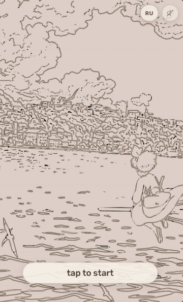

# 🎂 A Watercolor Birthday — Interactive Experience

An interactive, hand-drawn birthday micro-story. A line portrait is **drawn stroke by stroke**, **blooms into watercolor**, and guides the visitor through a short Ghibli-themed quest — ending with a cake that paints itself and a wish you can make. Built with **vanilla HTML / CSS / JavaScript**, no frameworks.

> ✨ Focus: motion design, SVG/Canvas animation and micro-interactions on a zero-dependency front end.

**🔗 Live demo:** _add your Vercel link_  ·  **💻 Code:** _this repo_

<!-- media/hero.gif -->


---

## Highlights

- **Hand-drawn reveal** — SVG paths animate via `stroke-dashoffset` with staggered timing, then a **watercolor wash** fills the art using SVG masks driven by `feTurbulence` + `feDisplacementMap` for organic, torn-paper edges (SMIL-triggered).
- **Cinematic routing** — a tiny screen router with **3D perspective transitions**, plus a **FLIP** animation where the cake shrinks and docks into the greeting card.
- **Canvas particles** — a confetti burst finale and a custom star-sparkle effect that flies off buttons on tap.
- **Sound, synthesized** — UI taps and a “watercolor brush” sound generated live with the **Web Audio API**; soft background music (Joe Hisaishi) that starts on the first gesture, with a persistent mute toggle.
- **Drag & drop** — arrange photos onto shelves with Pointer Events + pointer capture (touch & mouse).
- **Crafted details** — theme switching via CSS custom properties, responsive layout, `prefers-reduced-motion` fallbacks, ARIA roles + keyboard support, `webp` assets and baked deckle edges.

## Tech

`Vanilla JS` · `SVG` (masks, filters, SMIL) · `Canvas` · `Web Audio API` · `CSS` (custom properties, 3D transforms) · [`canvas-confetti`] · `GSAP` · deployed on `Vercel`

## A couple of things I solved

- **The “watercolor bloom” reveal.** A growing radial blot runs through a turbulence-displacement filter as a luminance mask over the colored artwork, so the paint appears to seep in with ragged, paper-like edges instead of a hard wipe.
- **The cake “cinema.”** The cake draws large and centered, then performs a FLIP into a small polaroid slot inside the card — measured at runtime and kept stable despite a `zoom`ed ancestor.
- **Pacing.** Sequencing draw → pause → paint → text so attention lands on one thing at a time, with a once-only / tap-to-skip path so nothing drags on repeat views.

## Run locally

```bash
# any static server, e.g.
python -m http.server 8000
# then open http://localhost:8000
```

## Credits & license

**Non-commercial fan / learning project.** Artwork is inspired by **Studio Ghibli**’s *Kiki’s Delivery Service*; background music is by **Joe Hisaishi**. All rights to those works belong to their respective owners. The **code** is mine and free to reference.

> For a fully “clean” public version, the Ghibli artwork and music can be swapped for original or royalty-free assets — the animation techniques and code are asset-agnostic.
